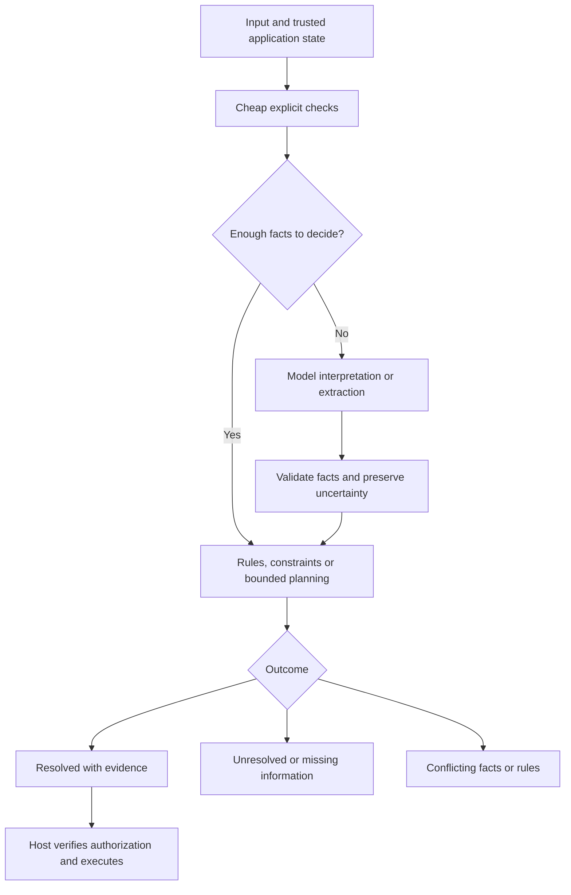

# Conceptual architecture

## Conceptual inputs

- Facts with types, origin, timestamps or validity bounds, and unknown values.
- Explicit application constraints and rule versions.
- Available actions with preconditions, predicted effects and costs.
- Objective, limits and current application state.
- Separate trusted authorization evidence supplied by the host.

Model confidence and source trust are separate concepts. A high probability does not grant authority. Untrusted input cannot rewrite rules or manufacture permission.

## Conceptual results

- RESOLVED: an answer established under the supplied facts, rules and stated reasoning scope, with its evidence and assumptions.
- UNRESOLVED: missing facts, remaining ambiguity, unsupported semantics or exhausted budget, with a specific reason.
- CONFLICT: contradictory facts or rules, with the relevant conflict identified where feasible.

These are vocabulary proposals, not a final API. A feasible plan and a proven optimal plan must be distinguished. A depth cutoff cannot be represented as proof of impossibility.

## Uncertainty and execution

Unknown is distinct from false. Preserve alternative interpretations where needed. Revalidate relevant preconditions immediately before an action; execution may change the world unexpectedly. Return observed results to the state and replan if appropriate.

Authorization, destructive-action policy and tool execution remain host responsibilities. The core must not autonomously execute a proposed plan. Loop limits and total budgets must include model interpretation, reasoning and fallback work.

## Caching and traces

Cache identity must include relevant facts, rules, objective and policy versions; time-sensitive facts need invalidation. Keep provenance sufficient to explain a decision, while avoiding secrets and unnecessary personal data in logs. No concrete storage design is selected.
